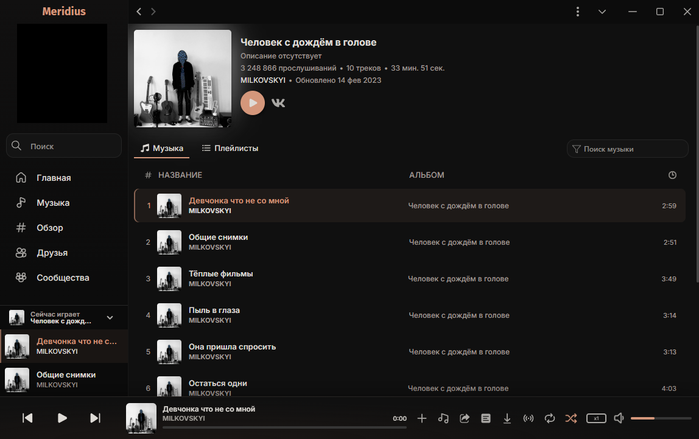

# Claude Gallery для Meridius

Неофициальная экспериментальная тёмная тема для [Meridius](https://github.com/PurpleHorrorRus/Meridius): почти чёрный фон, графитовые карточки и мягкие терракотовые акценты.

Визуальное направление вдохновлено палитрой Claude и галерейной подачей Pryzm. Проект не связан с Anthropic, Claude или авторами Pryzm и не является их официальным продуктом.

**Автор:** notbadis · **Версия темы:** 0.3.0 · **Целевая версия Meridius:** 3.4.0

## Что меняется

- Почти чёрный фон и нейтральные графитовые панели.
- Терракотовые акценты в элементах управления и выделении текущего трека.
- Скруглённые карточки плейлистов с тонкими контурами и отдельной областью подписи.
- Более спокойное оформление навигации, текстовых полей и нижнего плеера.
- Небольшой подъём карточки при наведении; при системной настройке уменьшения движения эффект отключается.
- Декоративные градиенты на поддерживаемых заглушках без обложек. Настоящие обложки не заменяются.

Тема меняет оформление, а не функции приложения. Общая компоновка, внешние размеры карточек и высота строк треков сохраняются.

## Установка вручную

1. Скачайте репозиторий через **Code → Download ZIP** и распакуйте архив.
2. Откройте папку конфигурации Meridius и перейдите в папку тем.
3. Создайте там папку **claude-cream**. Это технический идентификатор темы, сохранённый для совместимости с ранними версиями; отображаемое название — **Claude Gallery**.
4. Поместите в неё три файла из корня репозитория:
   - [manifest.json](manifest.json) — описание темы;
   - [main.css](main.css) — базовое оформление;
   - [gallery.css](gallery.css) — галерейный вариант.
5. В Meridius откройте **Настройки → Внешний вид**, нажмите **«Сканировать темы»** и выберите **Claude Gallery** среди пользовательских тем.
6. Если тема не появилась, перезапустите приложение.

Для обычной Windows-установки папка тем находится в каталоге AppData → Roaming → meridius → config → themes внутри профиля пользователя. При другой установке используйте фактическую папку конфигурации приложения.

Важно: файлы должны лежать непосредственно в папке темы, без дополнительной вложенной папки из ZIP-архива. Галерейный файл уже подключён как модуль — отдельно добавлять его в стилевые патчи не нужно.

## Установка через GitHub

Если ваша версия Meridius предлагает добавление темы по данным GitHub, используйте:

| Поле | Значение |
| --- | --- |
| Владелец | notbadis |
| Репозиторий | meridius-claude-gallery |
| Ветка | main |

[Открыть репозиторий](https://github.com/notbadis/meridius-claude-gallery)

Данные репозитория также указаны в [манифесте](manifest.json) для механизма обновлений Meridius. Установка из GitHub и автоматическое обновление этой темы пока не проверены; при затруднениях используйте ручную установку.

## Обновление и удаление

Для ручного обновления замените все три файла темы свежими версиями. Переключитесь на другую тему и обратно; при необходимости перезапустите Meridius. Список дополнительных модулей может потребовать повторного чтения темы.

Чтобы отключить оформление, выберите любую встроенную тему. После переключения папку Claude Gallery можно удалить.

## Ограничения и статус

Это экспериментальная версия, а не полностью протестированный релиз.

- Селекторы основных компонентов сверены со штатными стилями Meridius 3.4.0. Работа на других версиях не гарантируется.
- В галерейном варианте часть высоты карточки отведена под подпись, поэтому обложки могут кадрироваться.
- Разметка некоторых элементов и защищённые свойства приложения могут ограничивать применение стилей.
- После обновлений Meridius тема может потребовать доработки.
- Полная проверка всех экранов, миниплеера, клавиатурной навигации, масштабирования и кнопок поверх обложек ещё не выполнена.
- Прозрачность Acrylic не является целью этой темы: основные поверхности намеренно непрозрачные.
- Нет внешних шрифтов, сетевых изображений или дополнительных скриптов.

## Обратная связь

Личные контакты автора не публикуются. Если в репозитории включён раздел **Issues**, сообщения об ошибках можно оставлять там. Если раздел недоступен, публичный канал обратной связи пока не настроен.

В сообщении полезно указать версию Meridius, операционную систему, масштаб интерфейса, шаги воспроизведения и скриншот. Не публикуйте cookies, токены, файлы аккаунта или всю папку конфигурации приложения. Перед отправкой скриншотов скройте личные данные.

## Устройство темы

[main.css](main.css) содержит базовую тёмную тему и оформление компонентов. [gallery.css](gallery.css) подключается дополнительным модулем и задаёт галерейную палитру и карточки. [manifest.json](manifest.json) описывает совместимость, автора и источник обновлений.

При публикации эти файлы должны находиться в корне GitHub-репозитория. Локальная папка темы при ручной установке должна называться **claude-cream**; переименование одного только каталога нарушит соответствие техническому идентификатору.

## Благодарности

- [Meridius](https://github.com/PurpleHorrorRus/Meridius) — музыкальный плеер.
- [MeridiusTheme](https://github.com/PurpleHorrorRus/MeridiusTheme) — шаблон и документация механизма тем.

Сторонние названия принадлежат их владельцам. Этот репозиторий содержит тему, а не исходники приложения Meridius.
